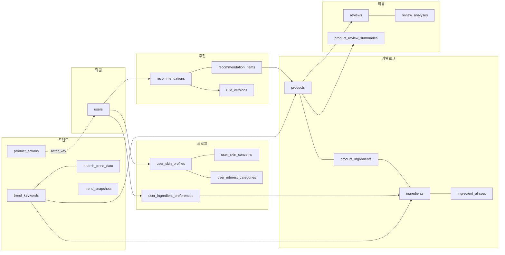
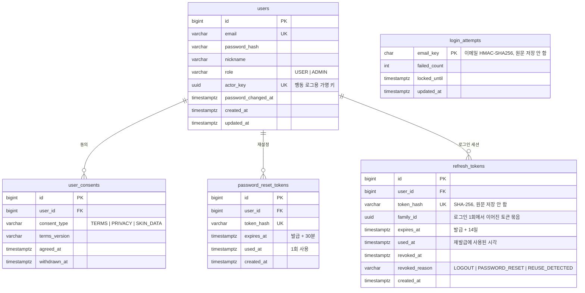
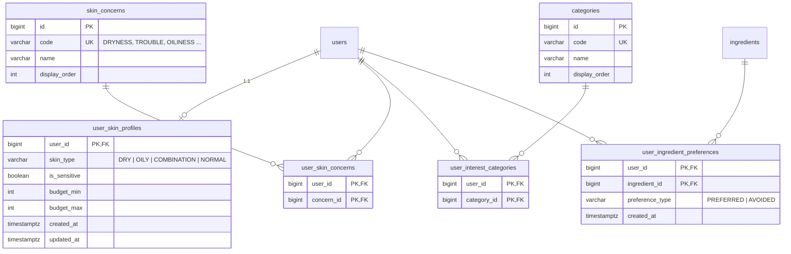
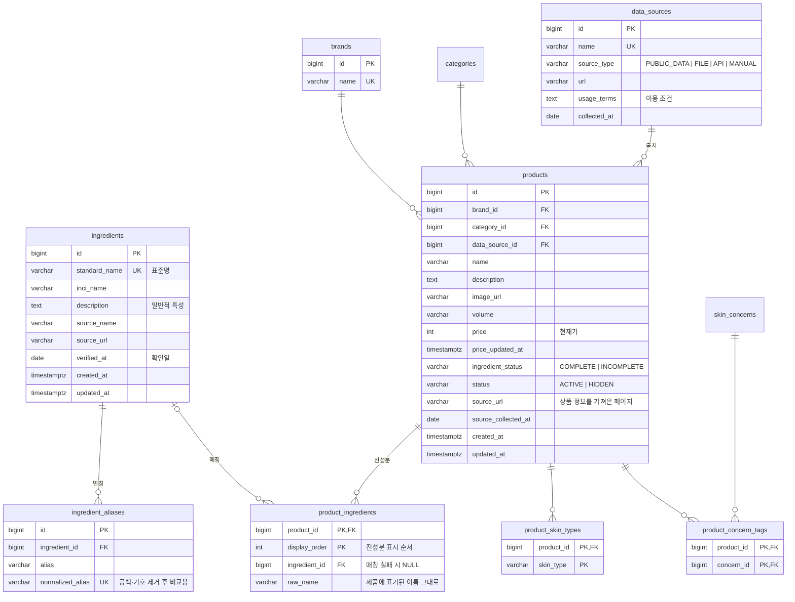
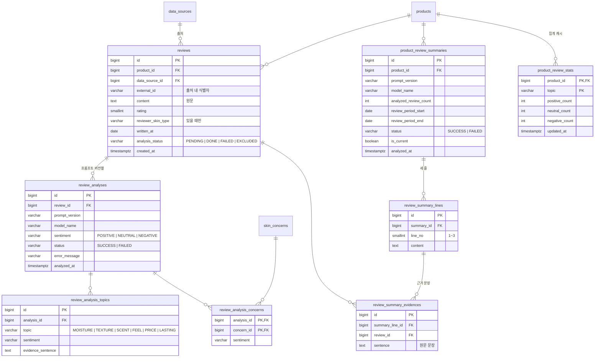
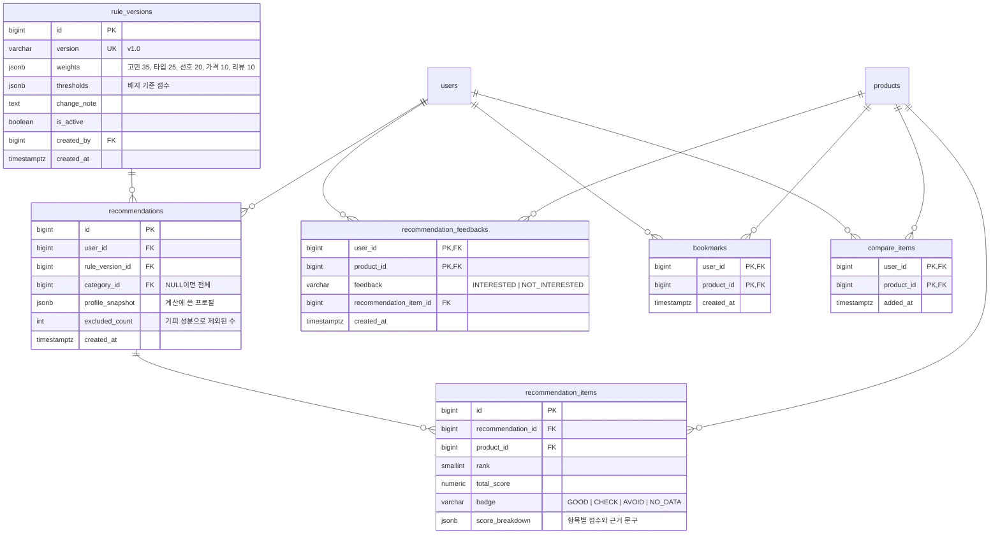
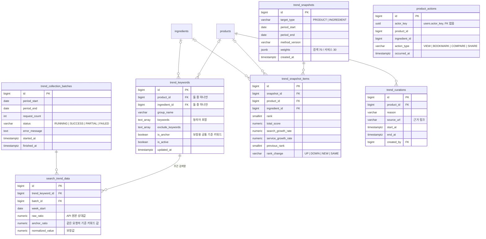
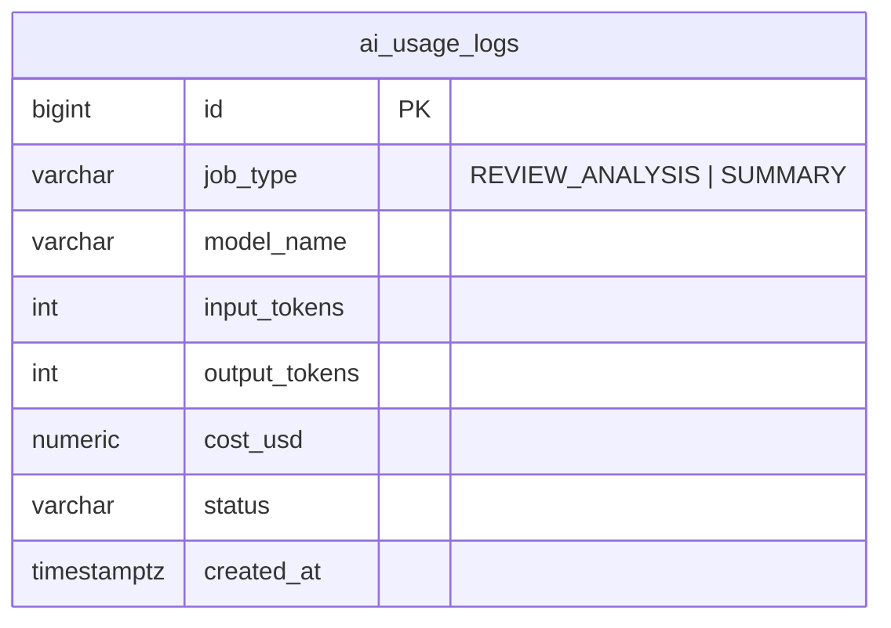

# ERD (데이터베이스 설계)

- 기준 문서: 요구사항 명세서 (FR 61개, NFR 41개)
- DB: PostgreSQL 17
- 상태: 확정 (마이그레이션 V2 회원·인증, V3~V7 나머지 테이블)

## 0. 설계 원칙

| 원칙 | 내용 | 관련 요구사항 |
|---|---|---|
| 원본과 가공 결과 분리 | 리뷰 원문과 AI 분석 결과, 외부 검색량 원본과 트렌드 점수를 서로 다른 테이블에 저장해, 분석 방식이 바뀌어도 원본에서 다시 계산할 수 있게 함 | FR-REV-07, FR-TRD-06 |
| 재현 가능성 | 추천 결과에 규칙 버전과 프로필 스냅샷을, 트렌드 스냅샷에 산정 방식과 가중치를 함께 저장 | FR-REC-07, FR-TRD-03 |
| 행동 데이터 분리 | 행동 로그에는 `user_id` 대신 계정과 분리된 `actor_key`만 저장. 탈퇴 시 계정이 삭제되면 행동 로그와의 연결이 끊어짐 | NFR-PRIV-04, 05 |
| 출처 기록 | 상품·리뷰·트렌드 데이터는 `data_sources`를, 성분 설명은 자체 출처 컬럼을 가짐 | NFR-LEG-02 |
| 코드 값 | PostgreSQL ENUM 대신 `varchar + CHECK 제약`으로 관리 (값 추가 시 마이그레이션이 단순함) | NFR-MNT-03 |

공통 규칙: PK는 `bigint generated always as identity`, 시각은 `timestamptz`, 금액은 원 단위 `integer`, 테이블·컬럼명은 snake_case.

## 1. 전체 구조

## 2. 회원·인증

| 항목 | 설계 내용 | 요구사항 |
|---|---|---|
| 이메일 중복 | `lower(email)`에 유니크 인덱스 | FR-AUTH-01 |
| 로그인 제한 | 이메일 기준 `login_attempts`에서 `failed_count`가 5회가 되면 `locked_until` 설정. 회원과 FK 없이 가입하지 않은 이메일도 똑같이 기록해 가입 여부가 드러나지 않게 함. 키는 이메일 HMAC 값이며 하루 지난 행은 정리 (FIX-006) | FR-AUTH-02 |
| 동의 분리 | 피부 정보 동의(`SKIN_DATA`)를 별도 행으로 저장하고 약관 버전을 기록 | FR-AUTH-01, NFR-PRIV-01 |
| 비밀번호 재설정 | 토큰 원문이 아닌 해시만 저장. 재설정 완료 시 해당 사용자의 `refresh_tokens`를 모두 `revoked_at` 처리 | FR-AUTH-05 |
| 탈퇴 | `users` 행을 삭제하고 프로필·북마크 등은 `ON DELETE CASCADE`로 함께 삭제. 행동 로그는 `actor_key`로만 연결되어 있어 개인 식별이 불가능해짐 | FR-AUTH-04 |

> 인증 방식은 JWT Access Token + Refresh Token으로 확정했습니다 ([ADR-004](decisions/ADR-004-인증-JWT.md)). Access Token은 DB에 저장하지 않고, Refresh Token만 해시로 저장합니다. Refresh Token은 재발급할 때마다 새 토큰으로 교체하며, 이미 사용된 토큰이 다시 들어오면 탈취로 보고 같은 `family_id`의 토큰을 모두 폐기합니다.

## 3. 피부 프로필

| 항목 | 설계 내용 | 요구사항 |
|---|---|---|
| 선호·기피 동시 등록 방지 | PK를 `(user_id, ingredient_id)`로 두어 한 성분은 선호와 기피 중 하나만 가능 | FR-PRF-03 |
| 개수 제한 | 고민 최대 3개, 기피 20개, 선호 10개는 애플리케이션에서 검증 | FR-PRF-01~03 |
| 가입 전 프로필 | 비회원이 입력한 프로필은 DB에 저장하지 않고 브라우저에 임시 보관, 가입 완료 시 저장 | FR-PRF-05, NFR-PRIV-01 |
| 기준 코드 | 화면 시안 기준으로 마이그레이션(V3)에서 함께 입력. 피부 고민 8개: `DRYNESS` 건조, `TROUBLE` 트러블, `OILINESS` 유분, `PORE` 모공, `DEAD_SKIN` 각질, `REDNESS` 붉은기, `ELASTICITY` 탄력, `DULLNESS` 칙칙함. 카테고리 6개: `TONER`, `SERUM`, `CREAM`, `SUNCARE`, `CLEANSING`, `MASK` | FR-PRF-01, FR-PRD-01 |
| 프로필 변경 이력 | 별도 이력 테이블을 두지 않음. 추천 결과 재현에 필요한 프로필은 `recommendations.profile_snapshot`에 함께 저장 | FR-REC-07 |

## 4. 성분·상품

| 항목 | 설계 내용 | 요구사항 |
|---|---|---|
| 별칭 통합 | 검색·매칭은 `ingredients.standard_name`과 `ingredient_aliases.normalized_alias`를 함께 조회. 부분 검색을 위해 `pg_trgm` GIN 인덱스 사용 | FR-ING-02, FR-SRC-01 |
| 표기 이름 보존 | `raw_name`을 저장해 "어떤 성분이 어떤 이름으로 들어 있는지" 표시 | FR-REC-02 |
| 매칭 실패 처리 | `ingredient_id`가 NULL인 행이 관리자 화면의 미매칭 목록이 됨 | FR-ADM-03 |
| 데이터 부족 | 전성분이 불완전하면 `ingredient_status = INCOMPLETE`로 두고 궁합 대신 "데이터 부족" 표시 | FR-PRD-03 |
| 궁합 점수 입력값 | 피부 타입 적합성은 `product_skin_types`, 피부 고민 관련성은 `product_concern_tags`로 판단. 상품 정보에서 운영자가 태깅 | 기획서 5.2 |
| 가격 | 현재가와 갱신 시각만 저장하고 가격 이력은 MVP 범위에서 제외 | 기획서 6.2 |
| 적재 기준 | `products (brand_id, name)` 유니크. 데이터 적재를 다시 실행하면 같은 상품은 새로 만들지 않고 갱신 | NFR-LEG-02 |
| 상품별 출처 | `data_sources`는 출처 종류(예: 브랜드 공식몰), `products.source_url`은 실제로 정보를 가져온 상품 페이지 | FR-ADM-02 |

## 5. 리뷰·AI 분석

| 항목 | 설계 내용 | 요구사항 |
|---|---|---|
| 중복 수집 방지 | `reviews (data_source_id, external_id)` 유니크 | FR-ADM-05 |
| 중복 분석 방지 | `review_analyses (review_id, prompt_version)` 유니크 | FR-REV-07 |
| 개인정보 마스킹 | 원문은 그대로 보관하고 외부 AI 전송 시점에 마스킹. 마스킹이 어려운 리뷰는 `analysis_status = EXCLUDED` | FR-REV-06 |
| 요약 근거 | 요약 문장마다 원문 리뷰 문장을 연결해 "근거 보기" 제공 | FR-REV-03 |
| 분석 범위 | 요약에 리뷰 수·기간·분석 시각을 저장 | FR-REV-04 |
| 피부 고민별 리뷰 경향 | `review_analysis_concerns`를 궁합 점수의 "리뷰 경향" 항목에 사용. 분석 리뷰 10건 미만이면 반영 비중을 낮춤 | FR-REC-08 |
| 집계 캐시 | 비교 화면의 주제별 경향은 `product_review_stats`에서 조회 (분석 배치 후 갱신) | FR-CMP-02, NFR-PERF-01 |

## 6. 추천·저장·비교

| 항목 | 설계 내용 | 요구사항 |
|---|---|---|
| 재현성 | 같은 `profile_snapshot` + 같은 상품 데이터 + 같은 `rule_version`이면 같은 결과 | FR-REC-07 |
| 근거 표시 | `score_breakdown`에 항목별 점수와 화면 문구 근거를 저장 | FR-REC-02 |
| 제외 안내 | `excluded_count`로 "기피 성분이 포함된 제품 8개를 제외했어요" 표시 | FR-REC-04 |
| 궁합 배지 | 피드·목록의 배지는 저장하지 않고 요청 시 계산 (프로필이 바뀌면 즉시 반영되어야 함). 성능 목표를 넘으면 캐시 검토 | FR-PRF-04, NFR-PERF-02 |
| 비교 목록 | 회원만 저장. 비회원은 브라우저에 보관하고 로그인 시 이관. 최대 3개는 애플리케이션에서 검증 | FR-CMP-01 |

## 7. 트렌드

| 항목 | 설계 내용 | 요구사항 |
|---|---|---|
| 제품·성분 대상 | `product_id`와 `ingredient_id` 중 정확히 하나만 값을 갖도록 CHECK 제약 (다형 ID 대신 FK 무결성 유지). 보정용 기준 키워드(`is_anchor`)는 둘 다 비워 둠 | FR-TRD-05 |
| 상대값 보정 | 원본 `raw_ratio`와 같은 요청의 `anchor_ratio`를 함께 저장해, 보정 방식이 바뀌어도 다시 수집하지 않고 재계산 | FR-TRD-06 |
| 수집 실패 | 배치 단위로 상태와 오류를 기록하고, 실패 시 직전 스냅샷을 그대로 노출 | FR-ADM-09, NFR-REL-03 |
| 중복 행동 1회 반영 | 집계 시 `(actor_key, 대상, action_type, 주)` 기준으로 중복 제거 | FR-TRD-03 |
| 행동 로그 보호 | `actor_key`에는 FK를 두지 않음. 계정이 삭제되면 누구의 행동인지 알 수 없게 됨 | NFR-PRIV-05 |
| 순위 근거 공개 | 스냅샷 항목에 신호별 증가율을 저장해 "검색량 32% 증가" 같은 근거를 표시 | FR-TRD-04 |
| 운영자 선정 분리 | 큐레이션은 스냅샷과 별도 테이블로 두어 집계 순위와 섞이지 않게 함 | FR-TRD-04, FR-ADM-06 |
| 스냅샷 유일성 | `trend_snapshots (target_type, period_start)` 유니크 | FR-TRD-02 |

## 8. 운영

| 항목 | 설계 내용 | 요구사항 |
|---|---|---|
| 비용 상한 | 월별 `cost_usd` 합계가 상한을 넘으면 신규 분석 중단 | NFR-AI-04, FR-ADM-07 |

## 9. 주요 인덱스

| 테이블 | 인덱스 | 용도 |
|---|---|---|
| users | `unique (lower(email))` | 로그인, 중복 확인 |
| ingredients / ingredient_aliases | `gin (standard_name gin_trgm_ops)`, `gin (alias gin_trgm_ops)` | 성분 부분 검색, 자동완성 |
| products | `gin (name gin_trgm_ops)`, `(category_id, status)`, `(brand_id)` | 상품 검색, 카테고리 목록 |
| product_ingredients | `(ingredient_id)` | 성분별 포함 제품, 기피 성분 제외 |
| reviews | `(product_id, written_at desc)`, `unique (data_source_id, external_id)` | 리뷰 목록, 중복 방지 |
| review_analyses | `unique (review_id, prompt_version)` | 중복 분석 방지 |
| product_actions | `(product_id, occurred_at)`, `(ingredient_id, occurred_at)` | 주간 집계 |
| search_trend_data | `unique (trend_keyword_id, week_start, batch_id)` | 수집 중복 방지 |
| trend_snapshot_items | `(snapshot_id, rank)` | 랭킹 조회 |

## 10. 결정 사항과 남은 과제

**이번에 결정한 것**
- 가격 이력은 저장하지 않고 현재가만 관리 (기획서 6.2의 미정 항목)
- 피부 프로필 변경 이력은 저장하지 않고, 추천 시점의 프로필을 스냅샷으로 보존 (기획서 6.2의 미정 항목)
- 궁합 배지는 저장하지 않고 요청 시 계산
- 인증은 JWT Access Token + Refresh Token (ADR-004)
- 데이터 접근 기술: 대부분 CRUD와 연관관계 조회라 **JPA 유지** (ADR-002 재검토 조건 확인). 트렌드 집계와 리뷰 통계처럼 집계 중심 쿼리는 네이티브 SQL로 작성

**남은 과제**
- 만료·폐기된 `refresh_tokens` 정리 배치 (만료 후 30일 지난 행 삭제)
- `product_actions` 데이터가 커지면 월 단위 파티셔닝 검토
- ~~확정 후 Flyway 마이그레이션 작성~~ → V3(카탈로그) · V4(프로필) · V5(리뷰) · V6(추천) · V7(트렌드·운영)으로 작성 완료
